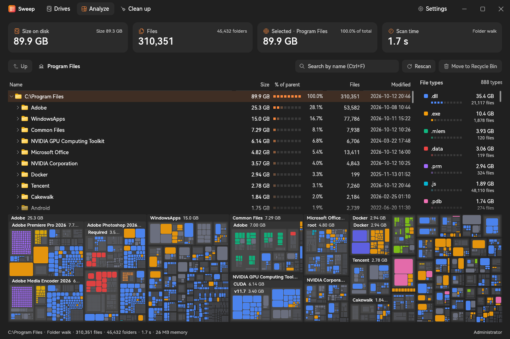

<p align="center">
  
  <h1 align="center">Sweep</h1>
  <p align="center">
    <a href="https://github.com/Jannchie/sweep/actions/workflows/ci.yml"></a>
  </p>
  <p align="center"><a href="README.md">中文</a> · English · <a href="README.ja.md">日本語</a></p>
  
</p>

Sweep is a disk usage analyzer for Windows that finds what takes up space with a folder tree, a treemap and file type statistics. It is written natively in Rust with egui and is available as an installer and as a portable single executable. The interface is available in English, Simplified Chinese and Japanese; it follows the Windows display language by default and can be changed under Settings → Appearance.

Compared with WinDirStat:

- Run as administrator, Sweep reads the NTFS master file table (MFT) directly instead of opening folders one by one. On a C: drive on an NVMe SSD (about 4.7 million files and folders, 730 GiB), reading the MFT took 5.2 s (8.9 s on the first run); Sweep's own multi-threaded folder walk took 64 s on the same volume.
- Scanning, file type statistics, treemap layout and cleanup suggestions run on background threads, so the window stays responsive; during a folder walk, the sizes of the top-level folders update live.
- After a deletion or rescan, only the affected part of the tree is updated; there is no need to rescan the drive.
- Incremental scans: scanning the same NTFS drive again loads the previous result and updates only the folders that changed since, as recorded in the USN change journal. On the C: drive above this takes 1.6 s instead of 5.5 s; when the journal no longer covers the gap, a full scan runs instead.
- Items are ranked by size on disk by default, so cloud placeholders, compressed and sparse files count as the space you get back by deleting them; hard links are counted once.
- The Clean up page lists common places to reclaim space: temporary files, browser caches, npm / Yarn / pnpm / pip / uv / Cargo / NuGet / Gradle / Hugging Face caches, node_modules and the Recycle Bin.
- The Apps page lists installed programs and Store apps, sorted by the actual size of their install folders. Select several and uninstall them in one go: apps with a registered quiet uninstall command, MSI, Inno Setup and NSIS installs, and Store apps are removed silently without their uninstall wizard; the rest open their own wizard.
- Near-zero CPU while idle: the window repaints only when data or input changes.

## Install

Download one of the following from [Releases](https://github.com/Jannchie/sweep/releases). Requires Windows 10 or 11 (x64).

- **Installer (recommended)**: `sweep-<version>-windows-x64-setup.exe` installs Sweep for all users to `C:\Program Files\Sweep` and adds a Start menu shortcut. It can be uninstalled from Settings → Apps.
- **Portable**: `sweep-<version>-windows-x64.exe` runs directly and writes no installation data.

Sweep checks for a new version at startup and once a day and shows a notice in the title bar; updates are downloaded, verified and installed only after you confirm. Automatic checks can be turned off under Settings → About.

## Quick start

```powershell
sweep.exe D:\Projects   # opens and analyzes this folder
```

Without arguments, click a drive on the Drives page to scan it, or choose "Scan a folder…" to analyze a single folder. When the scan finishes, the Analyze page shows the folder tree at the top, file types on the right and the treemap below.

## Common tasks

- **Find large folders**: the tree is sorted by size, and the "% of parent" column shows each item's share of its folder. Double-click the treemap to zoom into a folder and press Backspace to go up; click a file type on the right to highlight it in the treemap. Press Ctrl+F to search by name.
- **Clean caches**: open the Clean up page. Each card shows how much space it frees and what it contains; choose "Move to Recycle Bin" or "Delete permanently", and Sweep lists everything before deleting. The right side lists the largest files in the scanned location.
- **Delete to the Recycle Bin**: select an item in the tree or treemap and press Delete to move it to the Recycle Bin, or Shift+Delete to delete it permanently; both are also on the context menu. Recycled files still use disk space until the Recycle Bin is emptied.
- **Open and locate**: double-click a file or press Enter to open it with its default app; right-click to show it in File Explorer, copy its path, view properties or rescan a folder.

Reading the MFT requires running as administrator and scanning the root of an NTFS volume (such as `C:\`). In other cases (not elevated, a single folder, FAT / exFAT / ReFS or network drives) Sweep uses a multi-threaded folder walk. The Drives page offers "Restart as administrator". When elevated, the folder walk can also enter folders whose ACLs deny listing.

## Build from source

Requires Rust 1.88 or later and the MSVC toolchain (used to compile the executable's icon resource).

```powershell
cargo build --release   # output: target\release\sweep.exe
```

To publish a release, bump the version in `sweep/Cargo.toml` and push a matching tag (for example `v0.2.0`); CI checks that they match, builds it and creates the release.
