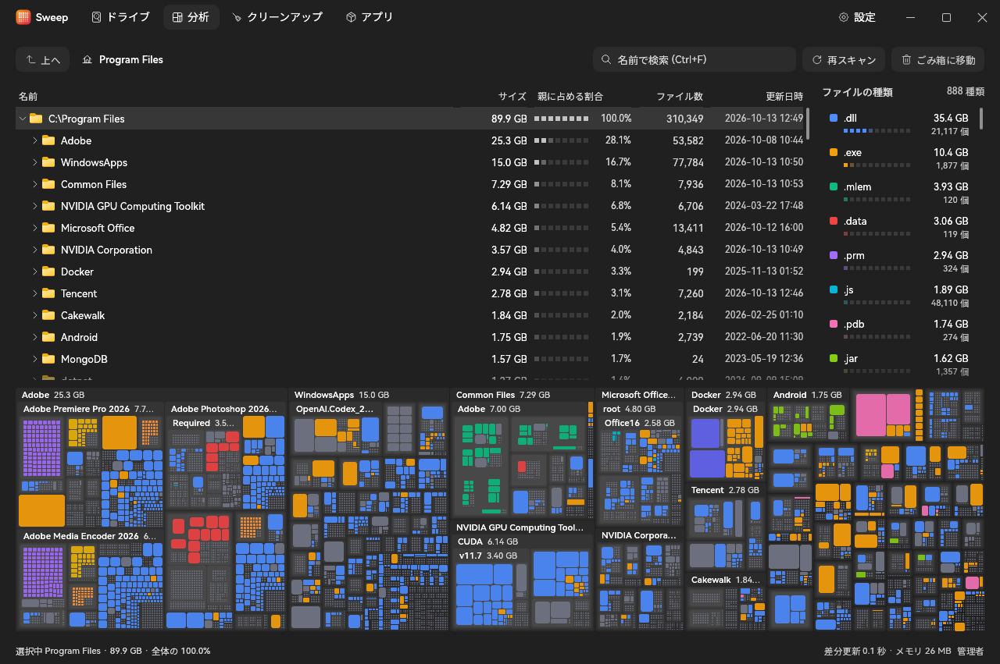

<p align="center">
  
  <h1 align="center">Sweep</h1>
  <p align="center">
    <a href="https://github.com/Jannchie/sweep/actions/workflows/ci.yml"></a>
  </p>
  <p align="center"><a href="README.md">中文</a> · <a href="README.en.md">English</a> · 日本語</p>
  
</p>

Sweep は Windows 用のディスク使用量分析ツールです。フォルダー ツリー、ツリーマップ、ファイルの種類別の集計で、容量を占めているファイルを見つけます。Rust と egui によるネイティブ実装で、インストーラー版と、インストール不要の単一実行ファイル (ポータブル版) を提供しています。表示言語は日本語、英語、簡体字中国語に対応し、既定では Windows の表示言語に従います。[設定] → [外観] で変更できます。

WinDirStat との違い:

- 管理者として実行すると、フォルダーを 1 つずつ開く代わりに NTFS のマスター ファイル テーブル (MFT) を直接読み取ります。NVMe SSD 上の C ドライブ (ファイルとフォルダー約 470 万個、730 GiB) では MFT の読み取りに 5.2 秒 (初回 8.9 秒) かかりました。同じボリュームを Sweep 自身のマルチスレッドのフォルダー走査で調べると 64 秒かかります。
- スキャン、ファイルの種類の集計、ツリーマップのレイアウト、クリーンアップのおすすめはバックグラウンド スレッドで計算するため、ウィンドウは常に操作できます。フォルダー走査中はルート直下の各フォルダーのサイズがリアルタイムに更新されます。
- 削除や再スキャンの後は、ツリーの該当部分だけを更新します。ドライブ全体をスキャンし直す必要はありません。
- 差分スキャン: 同じ NTFS ドライブを再スキャンすると前回の結果を読み込み、USN 変更ジャーナルに記録されたその後の変更があるフォルダーだけを更新します。上記の C ドライブでは 5.5 秒が 1.6 秒になります。間隔が長くジャーナルで追跡しきれない場合は完全スキャンになります。
- 既定ではディスク上のサイズで並べ替えるため、クラウドのプレースホルダー、圧縮ファイル、スパース ファイルは削除して実際に空く容量で計算されます。ハード リンクは 1 回だけ数えます。
- [クリーンアップ] ページには、一時ファイル、ブラウザーのキャッシュ、npm / Yarn / pnpm / pip / uv / Cargo / NuGet / Gradle / Hugging Face のキャッシュ、node_modules、ごみ箱など、空き領域を確保しやすい場所が表示されます。
- [アプリ] ページには、インストール済みのプログラムとストア アプリが、インストール フォルダーの実際のサイズ順に表示されます。複数選択してまとめてアンインストールできます。サイレント アンインストール コマンドが登録されたアプリ、MSI・Inno Setup・NSIS でインストールされたアプリ、ストア アプリはウィザードを表示せずにバックグラウンドで削除し、それ以外は各アプリのウィザードを開きます。
- アイドル時の CPU 使用率はほぼゼロです。データか入力が変化したときだけ再描画します。

## インストール

[Releases](https://github.com/Jannchie/sweep/releases) から次のいずれかをダウンロードしてください。Windows 10 または 11 (x64) が必要です。

- **インストーラー (推奨)**: `sweep-<バージョン>-windows-x64-setup.exe` は、すべてのユーザー向けに `C:\Program Files\Sweep` へインストールし、スタート メニューにショートカットを作成します。アンインストールは [設定] → [アプリ] から行えます。
- **ポータブル版**: `sweep-<バージョン>-windows-x64.exe` はダウンロードしてそのまま実行でき、インストール情報を書き込みません。

Sweep は起動時と 1 日 1 回、新しいバージョンを確認し、見つかった場合はタイトル バーでお知らせします。ダウンロード、検証、インストールは確認した後にのみ行われます。自動確認は [設定] → [バージョン情報] でオフにできます。

## クイック スタート

```powershell
sweep.exe D:\Projects   # 起動してこのフォルダーを分析
```

引数なしで起動した場合は、[ドライブ] ページでドライブをクリックしてスキャンするか、[フォルダーを選択…] または上部のパス欄で特定のフォルダーだけを分析します。スキャンが終わると [分析] ページに、上にフォルダー ツリー、右にファイルの種類、下にツリーマップが表示されます。

## よく使う操作

- **大きなフォルダーを探す**: ツリーはサイズ順に並び、[親に占める割合] 列に親フォルダー内での割合が表示されます。ツリーマップをダブルクリックするとそのフォルダーに拡大し、Backspace で 1 つ上の階層に戻ります。右側のファイルの種類をクリックすると、ツリーマップ内で強調表示されます。Ctrl+F で名前を検索できます。
- **キャッシュを削除する**: [クリーンアップ] ページの左側で [大きいファイル] またはクリーンアップできる場所を選ぶと、右側にその中のフォルダーとファイルがサイズ付きで表示されます。すべて、またはチェックしたものだけを [ごみ箱に移動] か [完全に削除] できます。削除する前に対象をすべて表示して確認します。
- **ごみ箱に移動する**: ツリーかツリーマップで項目を選び、Delete キーでごみ箱に移動、Shift+Delete で完全に削除します。右クリック メニューからも操作できます。ごみ箱に移動したファイルは、ごみ箱を空にするまでディスク領域を使い続けます。
- **ファイルが使用中のとき**: 削除できなかった項目について、それを使用しているプログラム (ファイルを開いている、DLL を読み込んでいる、作業ディレクトリがフォルダー内にあるターミナルなど) を調べ、終了して再試行できます。システムの重要なプロセスとエクスプローラーは終了しません。
- **開く・場所を表示する**: ファイルをダブルクリックするか Enter キーを押すと、既定のアプリで開きます。右クリックすると、エクスプローラーで表示、パスのコピー、プロパティの表示、フォルダーの再スキャンができます。

MFT を読み取るには、管理者として実行し、NTFS ボリュームのルート (`C:\` など) をスキャンする必要があります。それ以外の場合 (管理者として実行していない、特定のフォルダーだけを分析する、FAT / exFAT / ReFS、ネットワーク ドライブ) は、マルチスレッドのフォルダー走査を使います。[ドライブ] ページから [管理者として再起動] できます。管理者として実行すると、ACL で一覧表示が拒否されているフォルダーにも走査で入れます。

## ソースからのビルド

Rust 1.88 以降と MSVC ツールチェーン (exe のアイコン リソースのコンパイルに使用) が必要です。

```powershell
cargo build --release   # 出力先: target\release\sweep.exe
```

新しいバージョンを公開するには、`sweep/Cargo.toml` のバージョンを更新し、同じ名前のタグ (例: `v0.2.0`) をプッシュします。CI がバージョンの一致を確認してからビルドし、リリースを作成します。
