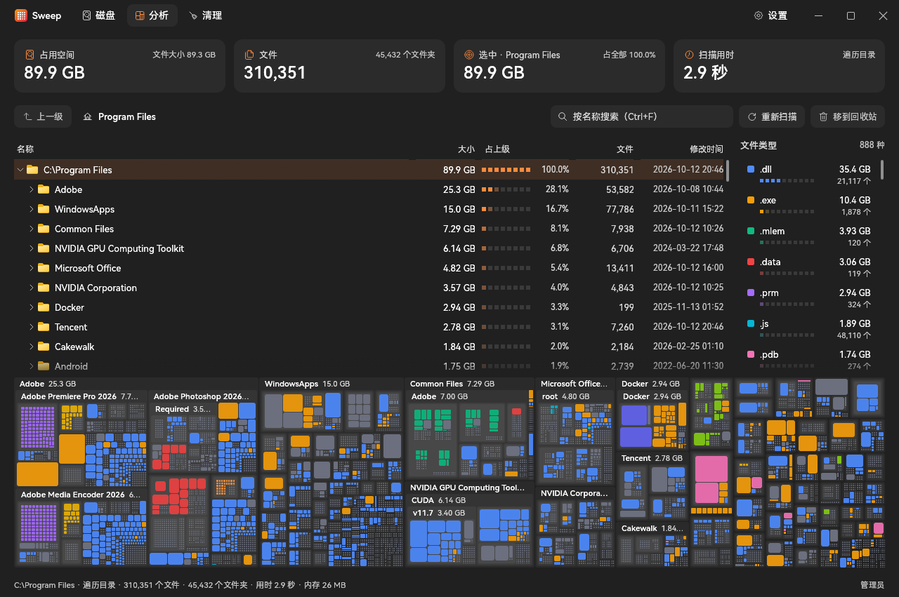

<p align="center">
  
  <h1 align="center">Sweep</h1>
  <p align="center">
    <a href="https://github.com/Jannchie/sweep/actions/workflows/ci.yml"></a>
  </p>
  <p align="center">中文 · <a href="README.en.md">English</a> · <a href="README.ja.md">日本語</a></p>
  
</p>

Sweep 是 Windows 上的磁盘空间分析工具，用目录树、矩形树图和文件类型统计找出占用空间的文件，使用 Rust 与 egui 原生实现，提供安装程序与免安装的单个 exe。界面支持简体中文、英文与日文，默认跟随 Windows 显示语言，可在「设置 → 外观」中切换。

与 WinDirStat 相比：

- 以管理员身份运行时直接读取 NTFS 主文件表（MFT），不逐个打开目录。在一块 NVMe 固态硬盘的 C 盘上（约 470 万个文件与文件夹，730 GiB），读取 MFT 用时 5.2 秒（首次 8.9 秒），同一个卷用 Sweep 自己的多线程目录遍历需要 64 秒。
- 扫描、类型统计、矩形树图布局和清理建议都在后台线程计算，界面始终可以操作；遍历目录时实时显示根目录下各文件夹的大小。
- 删除或重新扫描后只更新树上受影响的部分，不必重扫整个磁盘。
- 增量扫描：再次扫描同一块 NTFS 磁盘时载入上次的结果，按系统的 USN 变更日志只更新之后有变动的文件夹。上述 C 盘从 5.5 秒缩短到 1.6 秒；间隔过久、日志已不完整时自动改为完整扫描。
- 默认按磁盘上的实际占用排序，云盘占位文件、压缩文件和稀疏文件按删除后真正能腾出的空间计算；硬链接只计一次。
- 「清理」页列出常见的可回收位置：临时文件、浏览器缓存、npm / Yarn / pnpm / pip / uv / Cargo / NuGet / Gradle / Hugging Face 缓存、node_modules 与回收站。
- 「应用」页列出已安装的程序与商店应用，按安装目录的实际占用排序。可多选后一次卸载：程序登记了静默卸载命令的，以及 MSI、Inno Setup、NSIS 安装的程序和商店应用，都在后台静默卸载，不弹出卸载向导；其余打开程序自己的卸载向导。
- 空闲时几乎不占用 CPU：只在数据或输入变化时重绘。

## 安装

从 [Releases](https://github.com/Jannchie/sweep/releases) 下载以下任一文件。系统要求 Windows 10 或 11（x64）。

- **安装程序（推荐）**：`sweep-<版本>-windows-x64-setup.exe`，为所有用户安装到 `C:\Program Files\Sweep`，并创建开始菜单快捷方式。可在「设置 → 应用」中卸载。
- **便携版**：`sweep-<版本>-windows-x64.exe`，下载后直接运行，不写入安装信息。

Sweep 会在启动时及每天检查一次新版本，发现后在标题栏中提示，经确认后才下载、校验并安装；可在「设置 → 关于」中关闭自动检查。

## 快速上手

```powershell
sweep.exe D:\Projects   # 启动后直接分析这个文件夹
```

不带参数启动时，在「磁盘」页点击一个磁盘开始扫描，或点「选择文件夹…」、在顶部输入路径，只分析某个文件夹。扫描完成后进入「分析」页：上方是目录树，右侧是文件类型，下方是矩形树图。

## 常用用法

- **找出大文件夹**：目录树按大小排序，「占上级」一栏显示各项在上级文件夹中的比例。在矩形树图中双击放大到某个文件夹，Backspace 返回上一级；点击右侧的文件类型可在矩形树图中突出显示该类型。按 Ctrl+F 按名称搜索。
- **清理缓存**：打开「清理」页，在左侧选择「大文件」或某个可清理的位置，右侧列出其中的文件夹与文件及各自大小。可以全部或只勾选一部分「移到回收站」或「永久删除」，删除前会列出全部内容供确认。
- **删除到回收站**：在目录树或矩形树图中选中一项后按 Delete 移到回收站，Shift+Delete 永久删除；也可以右键选择。放进回收站的文件仍占用磁盘，清空回收站后才会腾出空间。
- **文件被占用时**：删不掉的项会自动查出是哪些程序在使用（打开着文件、加载着 DLL，或终端的工作目录在文件夹里），确认后可以结束这些程序并重试。系统关键进程和资源管理器不会被结束。
- **打开与定位**：双击文件或按 Enter 用默认程序打开；右键可在资源管理器中显示、复制路径、查看属性或重新扫描文件夹。

读取 MFT 需要以管理员身份运行，且扫描目标是 NTFS 卷的根目录（如 `C:\`）。其他情况（未以管理员身份运行、只扫描某个文件夹、FAT / exFAT / ReFS 或网络驱动器）使用多线程目录遍历。「磁盘」页提供「以管理员身份重启」。以管理员身份运行时，目录遍历还能进入 ACL 不允许列出的文件夹。

## 从源码构建

需要 Rust 1.88 或更高版本，以及 MSVC 工具链（用于编译 exe 的图标资源）。

```powershell
cargo build --release   # 产物位于 target\release\sweep.exe
```

发布新版本：修改 `sweep/Cargo.toml` 中的版本号并推送同名标签（如 `v0.2.0`），CI 会检查版本一致后构建并创建 Release。

## 许可证

[MIT](LICENSE)。可以自由使用、修改、分发，包括商用，只需保留版权与许可声明。
